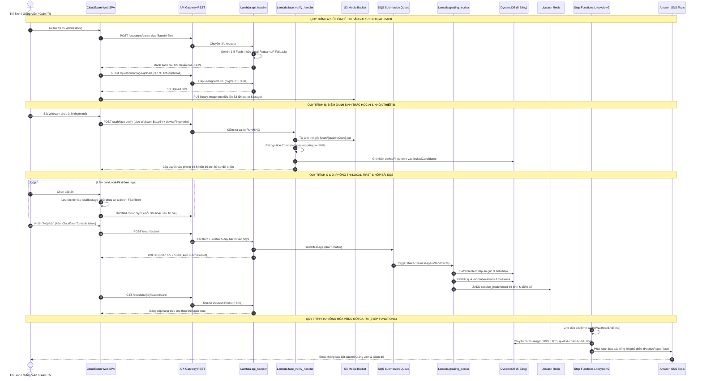

# CloudExam — Nền Tảng Khảo Thí Trực Tuyến Không Máy Chủ Thế Hệ Mới (Serverless, AI & Multi-Cloud Architecture)

[](https://cloudexam.id.vn)
[](https://aws.amazon.com/)
[](https://www.terraform.io/)
[](https://aws.amazon.com/ec2/graviton/)
[](https://vitejs.dev/)
[](https://cloud.google.com/)
[](docs/finops_report.md)
[](tests/)

> **Dự án Môn học:** Điện toán đám mây (Cloud Computing - INT3319 1)  
> **Đơn vị:** Nhóm 14 — Khoa Công nghệ Thông tin, Trường Đại học Công nghệ, ĐHQGHN (VNU-UET)  
> **Giảng viên hướng dẫn:** TS. Nguyễn Ngọc An  
> **Tên miền hệ thống:** [https://cloudexam.id.vn](https://cloudexam.id.vn)  
> **Khu vực Triển khai Chính:** AWS Asia Pacific (Singapore) `ap-southeast-1`

---

## MỤC LỤC
1. [Giới thiệu Dự án](#1-giới-thiệu-dự-án)
2. [Kiến trúc Hệ thống & Đặc tả Kỹ thuật](#2-kiến-trúc-hệ-thống--đặc-tả-kỹ-thuật)
   - [2.1. Mô hình Hạt nhân & Vệ tinh Đa Đám Mây (Hub-and-Spoke)](#21-mô-hình-hạt-nhân--vệ-tinh-đa-đám-mây-hub-and-spoke)
   - [2.2. Phân quyền Kiểm soát Truy cập 3 Cổng Độc Lập (RBAC)](#22-phân-quyền-kiểm-soát-truy-cập-3-cổng-độc-lập-rbac)
   - [2.3. Phân rã Vi dịch vụ Compute (AWS Lambda Graviton2 arm64)](#23-phân-rã-vi-dịch-vụ-compute-aws-lambda-graviton2-arm64)
   - [2.4. Tầng Lưu trữ Bền vững DynamoDB (5 Bảng On-Demand)](#24-tầng-lưu-trữ-bền-vững-dynamodb-5-bảng-on-demand)
   - [2.5. Tự động hóa Vòng đời Ca thi với AWS Step Functions & Amazon SNS](#25-tự-động-hóa-vòng-đời-ca-thi-với-aws-step-functions--amazon-sns)
   - [2.6. Sơ đồ Tuần tự 4 Quy trình Nghiệp vụ Cốt lõi (Sequence Diagram)](#26-sơ-đồ-tuần-tự-4-quy-trình-nghiệp-vụ-cốt-lõi-sequence-diagram)
   - [2.7. Đa Quốc Gia & Đa Thuê Bạ (Single-Table Multi-Tenancy & i18n 4 Ngôn ngữ)](#27-đa-quốc-gia--đa-thuê-bạ-single-table-multi-tenancy--i18n-4-ngôn-ngữ)
3. [Cấu trúc Thư mục Dự án](#3-cấu-trúc-thư-mục-dự-án)
4. [Hướng dẫn Cài đặt & Triển khai](#4-hướng-dẫn-cài-đặt--triển-khai)
   - [4.1. Yêu cầu Tiên quyết & Cấu hình AWS CLI](#41-yêu-cầu-tiên-quyết--cấu-hình-aws-cli)
   - [4.2. Bước 1: Triển khai Hạ tầng với Terraform](#42-bước-1-triển-khai-hạ-tầng-với-terraform)
   - [4.3. Bước 2: Nạp Dữ liệu Mẫu (Seed Data)](#43-bước-2-nạp-dữ-liệu-mẫu-seed-data)
   - [4.4. Bước 3: Khởi chạy Giao diện Frontend SPA & Tài khoản Kiểm thử](#44-bước-3-khởi-chạy-giao-diện-frontend-spa--tài-khoản-kiểm-thử)
   - [4.5. Bước 4: Đóng gói và Triển khai Production lên AWS](#45-bước-4-đóng-gói-và-triển-khai-production-lên-aws)
5. [Hướng dẫn Kiểm thử Toàn diện (Testing Guide & Benchmarks)](#5-hướng-dẫn-kiểm-thử-toàn-diện-testing-guide--benchmarks)
   - [5.1. Kiểm thử Tải Nộp bài Dồn dập 500 VUs (Submission Stampede - P99 = 42.47ms)](#51-kiểm-thử-tải-nộp-bài-dồn-dập-500-vus-submission-stampede---p99--4247ms)
   - [5.2. Kiểm thử Điểm danh Sinh trắc học AI Rekognition (100% Accuracy, FAR = 0.00%)](#52-kiểm-thử-điểm-danh-sinh-trắc-học-ai-rekognition-100-accuracy-far--000)
   - [5.3. Kiểm thử Tích hợp Đa Đám Mây Toàn diện (18/18 Tests PASS)](#53-kiểm-thử-tích-hợp-đa-đám-mây-toàn-diện-1818-tests-pass)
   - [5.4. Kiểm thử Tải SQS & Tường lửa WAF (Rate Limiting & DLQ Fault Tolerance)](#54-kiểm-thử-tải-sqs--tường-lửa-waf-rate-limiting--dlq-fault-tolerance)
   - [5.5. Kiểm thử Chịu lỗi Mạng Local-First Engine & Khôi phục F5 trong DevTools](#55-kiểm-thử-chịu-lỗi-mạng-local-first-engine--khôi-phục-f5-trong-devtools)
6. [Chiến lược Quản trị Chi phí 0 USD (FinOps Strategy & AWS Cost Explorer)](#6-chiến-lược-quản-trị-chi-phí-0-usd-finops-strategy--aws-cost-explorer)
7. [Thành viên Nhóm & Phân công Nhiệm vụ](#7-thành-viên-nhóm--phân-công-nhiệm-vụ)
8. [Tài liệu Kỹ thuật Tham khảo](#8-tài-liệu-kỹ-thuật-tham-khảo)

---

## 1. GIỚI THIỆU DỰ ÁN

**CloudExam** là giải pháp nền tảng khảo thí trực tuyến thế hệ mới, ứng dụng toàn diện triết lý **Serverless Hướng Sự kiện (Event-Driven Architecture - EDA)** và **Điện toán Đa Đám Mây (Multi-Cloud)**, hướng tới giải quyết triệt để 5 thách thức lớn nhất của các hệ thống thi cử truyền thống:

1. **Chống sập do xung tải nộp bài giây cuối (Thundering Herd / Submission Stampede):** Vào những giây cuối cùng của ca thi, hàng ngàn thí sinh đồng loạt nhấn nút nộp bài. CloudExam sử dụng mẫu hình **Queue-Based Load Leveling** qua **Amazon SQS** và **Dead Letter Queue (DLQ)** để bộ đệm hấp thụ 100% xung tải, trả về phản hồi `< 50ms` cho thí sinh và chấm điểm ngầm theo lô (Batch 10).
2. **Chống thi hộ bằng Sinh trắc học AI & Khóa phần cứng thiết bị:** Sử dụng **Amazon Rekognition CompareFaces** đối soát khuôn mặt chụp trực tiếp từ webcam với ảnh thẻ gốc lưu trữ tại **Amazon S3** (ngưỡng độ tương đồng $\ge 80\%$), hiển thị ảnh hồ sơ tham chiếu song song, kết hợp trích xuất mã định danh phần cứng (`deviceFingerprint`) tự động khóa máy, ngăn chặn hành vi đăng nhập trên thiết bị thứ hai.
3. **Số hóa ngân hàng câu hỏi thần tốc bằng AI Tạo sinh & Regex Fallback:** Tích hợp **Google Gemini 1.5 Flash AI** kết hợp bộ phân giải cục bộ **Regex NLP Fallback Parser**, tự động bóc tách đề thi từ tệp tài liệu Word `.docx` 50 câu thành danh sách câu hỏi trắc nghiệm JSON chuẩn hóa chỉ trong 2 giây, hoạt động bền bỉ ngay cả khi không có kết nối ra ngoài.
4. **Phòng thi Local-First & Bảng xếp hạng siêu tốc:** Thiết kế trải nghiệm làm bài **Local-First (0ms lag)** lưu trực tiếp vào trình duyệt qua `localStorage`, kết hợp cơ chế đồng bộ nền điều tiết (**Throttled Cloud Sync: 60 giây hoặc 10 thay đổi**) chống mất bài khi đứt mạng. Kết quả thi được cập nhật trực tiếp lên **Upstash Serverless Redis** với độ trễ `< 5ms`.
5. **Tối ưu chi phí $0.00 (Zero-Cost FinOps):** Kiến trúc vận hành 100% trong giới hạn **AWS Free Tier** và các gói dịch vụ đám mây vệ tinh miễn phí vĩnh viễn, được kiểm soát chặt chẽ bằng **AWS Budgets** ($0.50 alert threshold), **CloudWatch Billing Alarms**, và đã được chứng minh đạt **đúng $0.00 trên AWS Cost Explorer**.

---

## 2. KIẾN TRÚC HỆ THỐNG & ĐẶC TẢ KỸ THUẬT

### 2.1. Mô hình Hạt nhân & Vệ tinh Đa Đám Mây (Hub-and-Spoke)

Hệ thống kết hợp giữa **AWS Cloud Core Backbone** (Hạt nhân đảm bảo độ tin cậy, lưu trữ và định danh) và **Multi-Cloud Satellites** (Vệ tinh cung cấp AI tạo sinh, bộ đệm siêu tốc và lá chắn bảo vệ biên hoàn toàn miễn phí):

```
                                 [ MULTI-CLOUD INGRESS & CLIENT ]
                        Thí sinh (Candidates) · Giám thị (Proctors) · Giảng viên (Organizers)
                                                    │
                                                    ▼
                               ┌───────────────────────────────────────────┐
                               │     CloudExam Web SPA (React 19 + Vite)   │
                               │  • Local-First Engine (localStorage 0ms)  │
                               │  • Direct-to-Storage S3 Upload (Presign)  │
                               │  • Invisible Challenge Anti-Bot Shield    │
                               │  • Tên miền chính thức: cloudexam.id.vn   │
                               └─────────────────────┬─────────────────────┘
                                                     │
                    ┌────────────────────────────────┼────────────────────────────────┐
                    │                                │                                │
                    ▼                                ▼                                ▼
        [ CLOUDFLARE SATELLITE ]          [ AWS CORE GATEWAY ]             [ GOOGLE AI SATELLITE ]
        Cloudflare Turnstile              Amazon API Gateway REST API      Google Gemini 1.5 Flash
        (Xác thực CAPTCHA Tàng hình       • Cognito JWT Authorizer (RS256) • Bóc tách đề thi DOCX (Free)
         Chống bot nộp bài - 0 USD)       • WAFv2 Token & Rate Limiter     • Trợ lý AI giải thích bài thi
                    │                                │                                │
                    └───────────────────────┬────────┴────────────────────────────────┘
                                            ▼
                             [ SERVERLESS COMPUTE BACKBONE ]
                      AWS Lambda Functions (Python 3.11 · Graviton2 arm64)
                      ┌────────────────────────────────────────────────────────┐
                      │ 1. api_handler.py: Core API, RBAC, Gemini + Fallback   │
                      │ 2. face_verify_handler.py: Điểm danh AI Rekognition 1:1│
                      │ 3. grading_worker.py: SQS Consumer chấm bài theo Batch │
                      └────────────────────────────┬───────────────────────────┘
                                                   │
                  ┌────────────────────────────────┼────────────────────────────────┐
                  ▼                                ▼                                ▼
       [ AMAZON SQS & DLQ ]             [ DYNAMODB ON-DEMAND ]           [ UPSTASH REDIS SATELLITE ]
       • Submission Standard Queue      5 Bảng NoSQL PAY_PER_REQUEST     Upstash Serverless Redis
       • Dead Letter Queue (DLQ)        • QuestionBanks, Questions       • Live Leaderboard <5ms
       • Batch 10 / Window 2s           • Candidates, Sessions           • ZADD / ZREVRANGE
       • Chống sập nghẽn giây cuối      • Submissions (Sparse GSI)       • Miễn phí 10,000 req/ngày
```

---

### 2.2. Phân quyền Kiểm soát Truy cập 3 Cổng Độc Lập (RBAC)

Hệ thống thiết lập 3 cổng đăng nhập và bảng điều khiển độc lập theo vai trò người dùng (Role-Based Access Control):

| Cổng Đăng Nhập | Nhóm Cognito / Phân Vai | Giao Diện Frontend | Quyền Hạn Kỹ Thuật & Nghiệp Vụ Cốt Lõi |
| :--- | :--- | :--- | :--- |
| **Cổng Giảng viên** | `Organizer` | Bàn Giảng viên & Quản trị | • CRUD Ngân hàng đề thi, nạp đề Word DOCX bằng AI.<br>• Quản trị hồ sơ thí sinh, đồng bộ ảnh thẻ S3.<br>• Khởi tạo ca thi, cấu hình mật khẩu phòng thi, phân công Giám thị (`proctorEmails`), gán danh sách thí sinh (`candidateEmails`).<br>• Xem bảng điểm chi tiết và phân tích phổ điểm. |
| **Cổng Giám thị** | `Proctor` | `LiveProctorDashboard.tsx`<br>(Bàn Giám thị) | • Giám sát trực tiếp trạng thái thí sinh trong ca thi phụ trách.<br>• Phát hiện thí sinh bị khóa thiết bị và bấm **"Mở khóa máy"** (`lockedCandidates`).<br>• Cập nhật mật khẩu phòng thi khi có sự cố.<br>• Kích hoạt phát hành email báo cáo kết quả ca thi qua **Amazon SNS Topic**. |
| **Cổng Thí sinh** | `Candidate` | `CandidateRoomLogin.tsx` & `ExamRoom.tsx` | • Đăng nhập tại `https://cloudexam.id.vn/?exam=<sessionId>` bằng Email + Mật khẩu phòng thi.<br>• Bật camera đối soát sinh trắc học khuôn mặt Rekognition 1:1, tự động khóa thiết bị.<br>• Làm bài thi phòng thi Local-First (0ms lag), lưu nháp tự động.<br>• Xác thực Turnstile chống bot và nộp bài an toàn qua hàng đợi Amazon SQS. |

---

### 2.3. Phân rã Vi dịch vụ Compute (AWS Lambda Graviton2 arm64)

Hạ tầng tính toán sử dụng kiến trúc vi xử lý **AWS Graviton2 (arm64)** với runtime **Python 3.11**, mang lại hiệu năng cao hơn 20% và chi phí thấp hơn 20% so với x86:

| Tên Vi Dịch Vụ | Tên Hàm Lambda Terraform | Tệp Mã Nguồn | Vai Trò & Nghiệp Vụ Chính |
| :--- | :--- | :--- | :--- |
| **Core API Controller** | `cloudexam-core-api-dev` | [`backend/lambda/api_handler.py`](backend/lambda/api_handler.py) | • CRUD Ngân hàng câu hỏi, Câu hỏi, Thí sinh, Ca thi.<br>• Cấp S3 Presigned URL (Direct-to-Storage SigV4 TTL 300s).<br>• Bóc tách đề thi DOCX bằng Gemini AI hoặc Local Regex NLP Fallback.<br>• Cấp đề thi cho thí sinh (`GET /sessions/{id}/exam-paper`), **loại bỏ tuyệt đối correctAnswer chống F12**.<br>• Xác thực Cloudflare Turnstile và đẩy bài thi vào SQS (`POST /exam/submit`).<br>• Cung cấp bảng xếp hạng Redis (`GET /sessions/{id}/leaderboard`).<br>• Trợ lý AI giải thích đáp án sai (`POST /exam/explain-answers`).<br>• Phát hành báo cáo tổng kết qua Amazon SNS Topic (`cloudexam-exam-reports-dev`). |
| **Biometric Face Verifier** | `cloudexam-face-verify-dev` | [`backend/lambda/face_verify_handler.py`](backend/lambda/face_verify_handler.py) | • Triển khai trong VPC Private Subnets, kết nối qua PrivateLink.<br>• Kiểm tra điều kiện ca thi đang mở (`RUNNING`) và thí sinh hợp lệ.<br>• Nạp ảnh thẻ gốc từ S3 `faces/{studentCode}.jpg` và ảnh webcam.<br>• Gọi Amazon Rekognition `compare_faces` với ngưỡng tương đồng $\ge 80\%$.<br>• Ghi nhận `deviceFingerprint` và khóa thiết bị trong `lockedCandidates`.<br>• Trả về thông tin thí sinh kèm `faceImageUrl` và token vào phòng thi. |
| **Grading Worker** | `cloudexam-grading-worker-dev` | [`backend/lambda/grading_worker.py`](backend/lambda/grading_worker.py) | • Lắng nghe SQS Event Source Mapping (`BatchSize = 10`, `BatchingWindow = 2s`).<br>• Lấy đáp án gốc bằng DynamoDB `BatchGetItem` tối ưu IOPS.<br>• Chấm điểm, ghi kết quả kép (*Dual-Write*):<br>  1. `CloudExam_Submissions_dev`<br>  2. `CloudExam_Sessions_dev` (cập nhật trạng thái `SUBMITTED`).<br>• Đẩy điểm số tức thì lên **Upstash Redis Leaderboard** qua lệnh ZADD.<br>• Chuyển tự động vào Dead-Letter Queue (DLQ) sau 3 lần lỗi (`maxReceiveCount = 3`). |

---

### 2.4. Tầng Lưu trữ Bền vững DynamoDB (5 Bảng On-Demand)

Cơ sở dữ liệu được cấu hình ở chế độ **PAY_PER_REQUEST ($0.00 idle cost)**, tự động mở rộng theo lưu lượng thực tế:

```
┌────────────────────────────────────────────────────────────────────────────────────────────────────────┐
│                              5 BẢNG DYNAMODB ON-DEMAND DỰ ÁN CLOUDEXAM                                 │
├───────────────────────────────┬───────────────────┬───────────────────┬────────────────────────────────┤
│ Tên Bảng (Environment: dev)   │ Partition Key     │ Sort Key          │ Chỉ mục Toàn cục (GSI)         │
├───────────────────────────────┼───────────────────┼───────────────────┼────────────────────────────────┤
│ CloudExam_QuestionBanks_dev   │ id (String)       │ —                 │ —                              │
│ CloudExam_Questions_dev       │ id (String)       │ —                 │ BankIdIndex (bankId)           │
│ CloudExam_Candidates_dev      │ email (String)    │ —                 │ StudentCodeIndex (studentCode) │
│ CloudExam_Sessions_dev        │ id (String)       │ —                 │ —                              │
│ CloudExam_Submissions_dev     │ id (String)       │ —                 │ SessionResultsIndex            │
│                               │                   │                   │ (PK: sessionId, SK: score DESC)│
└───────────────────────────────┴───────────────────┴───────────────────┴────────────────────────────────┘
```

> [!NOTE]
> **Các thuộc tính mở rộng trên bảng `CloudExam_Sessions_dev`:**
> - `roomPassword`: Mật khẩu vào phòng thi (cho thí sinh tự nhập tại cổng phòng thi).
> - `proctorEmails`: Danh sách email cán bộ Giám thị được phân công coi ca thi.
> - `lockedCandidates`: Map lưu trữ định danh thiết bị `{ email: { deviceFingerprint, lockedAt } }` ngăn chặn đăng nhập đa thiết bị và thi hộ.
> - `status`: `DRAFT`, `SCHEDULED`, `RUNNING`, `COMPLETED`.

---

### 2.5. Tự động hóa Vòng đời Ca thi với AWS Step Functions & Amazon SNS

Máy trạng thái `cloudexam-exam-lifecycle-v2-dev` tự động hóa 100% chu trình ca thi:
1. **Chờ đến giờ kết thúc (`WaitUntilEndTime`):** Đưa execution vào trạng thái ngủ cho đến đúng mốc thời gian kết thúc (`endTime`), không tốn CPU.
2. **Tự động đóng phòng & Chấm bù bài nháp (`AutoFinalizeTask`):** Tự động chuyển ca thi sang trạng thái `COMPLETED`, quét các bài thi nháp lưu trong DynamoDB của các thí sinh chưa kịp bấm nộp bài để tự động chấm điểm và bảo vệ kết quả của thí sinh.
3. **Phát hành báo cáo điểm số (`PublishReportTask`):** Tổng hợp phổ điểm ca thi (điểm cao nhất, điểm trung bình, số lượng bài thi) và gửi email thông báo tức thì qua **Amazon SNS Topic (`cloudexam-exam-reports-dev`)** đến Cán bộ Giám thị và Giảng viên phụ trách.

---

### 2.6. Sơ đồ Tuần tự 4 Quy trình Nghiệp vụ Cốt lõi (Sequence Diagram)



---

### 2.7. Đa Quốc Gia & Đa Thuê Bạ (Single-Table Multi-Tenancy & i18n 4 Ngôn ngữ)

- **Cơ chế Single-Table Multi-Tenancy:** Phân định dữ liệu bằng tiền tố phân vùng ISO (`TENANT#VN#...`, `TENANT#LA#...`), tiết kiệm 100% chi phí quản trị đa database.
- **Hỗ trợ 4 ngôn ngữ:** Tiếng Việt (`vi`), Tiếng Anh (`en`), Tiếng Lào (`la`), Tiếng Đức (`de`).
- **Giao diện thương hiệu quốc gia động:**
  - Việt Nam (`cloudexam.vn`): Theme đỏ cờ hoa anh dũng ([`frontend/src/themes/vn.ts`](frontend/src/themes/vn.ts)).
  - Lào (`edulao.la`): Theme xanh đậm Champa thanh bình ([`frontend/src/themes/la.ts`](frontend/src/themes/la.ts)).
  - Đức & Quốc tế: Theme xám xanh hiện đại.

---

## 3. CẤU TRÚC THƯ MỤC DỰ ÁN

```text
ExamInTheCloud/
├── backend/                             # Hạ tầng Đám mây & Vi dịch vụ Backend
│   ├── lambda/                          # Mã nguồn AWS Lambda Functions (Python 3.11 / arm64)
│   │   ├── api_handler.py               # Vi dịch vụ Core API, RBAC 3 Cổng, Gemini + Fallback
│   │   ├── face_verify_handler.py       # Vi dịch vụ Điểm danh Sinh trắc học AI & Khóa máy
│   │   └── grading_worker.py            # Vi dịch vụ Chấm thi ngầm từ hàng đợi SQS theo lô
│   ├── terraform/                       # Infrastructure as Code (IaC) chuẩn hóa
│   │   ├── provider.tf                  # Provider AWS ap-southeast-1 & Backend Remote S3 Lock
│   │   ├── variables.tf                 # Khai báo biến môi trường hạ tầng
│   │   ├── api_gateway.tf               # REST API Gateway, Routes, Authorizer & CORS
│   │   ├── cognito.tf                   # Cognito User Pool, Client PKCE & 3 Nhóm RBAC
│   │   ├── dynamodb.tf                  # 5 Bảng DynamoDB NoSQL On-Demand & GSI
│   │   ├── lambda.tf                    # Đóng gói và triển khai Lambda Graviton2 arm64
│   │   ├── iam.tf                       # IAM Execution Roles tuân thủ PoLP
│   │   ├── s3.tf                        # S3 Media Bucket, CORS & Lifecycle 24h xóa ảnh tạm
│   │   ├── sqs.tf                       # Amazon SQS Standard Queue & Dead Letter Queue (DLQ)
│   │   ├── step_functions.tf            # Máy trạng thái điều phối chu trình ca thi (v2)
│   │   ├── waf.tf                       # AWS WAFv2 Web ACL Rate Limiting & Bot Shield
│   │   ├── route53.tf                   # Cấu hình DNS Route 53 & ACM SSL cho cloudexam.id.vn
│   │   ├── budgets.tf                   # Quản trị ngân sách FinOps AWS Budgets $0.50
│   │   └── cloudwatch.tf                # Giám sát Alarms (SQS Lag, Lambda Errors, SNS)
│   └── data/                            # Dữ liệu mẫu (Seed Data) & Scripts quản trị
│       ├── questions_seed.json          # Ngân hàng đề thi mẫu chuẩn hóa
│       ├── candidates_seed.json         # Danh sách thí sinh & liên kết ảnh thẻ S3
│       ├── sessions_seed.json           # Dữ liệu mẫu ca thi trực tuyến
│       ├── sample_exam_ses101.docx      # Đề thi Word mẫu 50 câu SES101 dùng thử nghiệm
│       ├── seed_dynamodb.py             # Script nạp dữ liệu chuẩn vào 5 bảng DynamoDB
│       ├── seed_cognito.py              # Script tạo tài khoản và gán nhóm Cognito RBAC
│       └── upload_sample_faces.py       # Script đồng bộ ảnh thẻ chân dung lên S3 Media Bucket
├── frontend/                            # Giao diện Người dùng Web Single Page Application (SPA)
│   ├── src/
│   │   ├── components/                  # Các màn hình chức năng chính
│   │   │   ├── CandidateRoomLogin.tsx   # Cổng đăng nhập phòng thi cho thí sinh (email + mật khẩu ca)
│   │   │   ├── ExamRoom.tsx             # Màn hình phòng thi Local-First, camera AI & nộp bài
│   │   │   ├── LiveProctorDashboard.tsx # Bàn Giám thị: giám sát, mở khóa máy & gửi báo cáo SNS
│   │   │   ├── ExamSessionTab.tsx       # Quản lý ca thi, cấp link thi & bảng xếp hạng (Giảng viên)
│   │   │   ├── QuestionBankTab.tsx      # Quản lý ngân hàng câu hỏi & nạp Word DOCX (Gemini AI)
│   │   │   ├── CandidatesTab.tsx        # Quản trị hồ sơ thí sinh & ảnh chân dung
│   │   │   ├── LiveLeaderboard.tsx      # Widget bảng xếp hạng trực tiếp Upstash Redis (< 5ms)
│   │   │   ├── TurnstileCaptcha.tsx     # Widget xác thực người thật Cloudflare Turnstile
│   │   │   ├── SessionResultsModal.tsx  # Modal bảng điểm chi tiết & phân tích phổ điểm
│   │   │   └── Callback.tsx             # Tiếp nhận OAuth2 Authorization Code PKCE
│   │   ├── services/                    # Tầng giao tiếp mạng & Dịch vụ ngoài
│   │   │   ├── apiService.ts            # Client Axios gọi API Gateway (hỗ trợ Dual-Mode & Retry)
│   │   │   ├── auth.ts                  # Quản lý phiên đăng nhập Cognito PKCE & phân vai
│   │   │   └── s3Service.ts             # Hỗ trợ tải tệp ảnh trực tiếp lên S3 (Direct-to-Storage)
│   │   ├── locales/                     # Bộ từ điển đa ngôn ngữ (vi, en, la, de)
│   │   └── themes/                      # Giao diện thương hiệu quốc gia (VN, LA, DE, Default)
│   ├── .env                             # Cấu hình biến môi trường Frontend
│   └── vite.config.ts                   # Cấu hình Vite & Tailwind CSS v4
├── docs/                                # Hồ sơ Báo cáo Khoa học & Minh chứng Nghiệm thu
│   ├── report/                          # Thư mục Báo cáo Tổng kết Đồ án Chính thức
│   │   ├── REPORT.md                    # BÁO CÁO TỔNG KẾT ĐỒ ÁN CHI TIẾT (5 CHƯƠNG TOÀN DIỆN)
│   │   ├── README.md                    # Danh mục tra cứu 27 hình ảnh minh chứng nghiệm thu
│   │   └── image1.png ... image27.jpg   # 27 sơ đồ kiến trúc & ảnh chụp console thực nghiệm
│   ├── evidence/                        # Bằng chứng kiểm thử Console & Terminal (Locust, WAF, SQS)
│   ├── demo/
│   │   └── KICH_BAN_QUAY_DEMO.md        # Kịch bản chi tiết quay video demo hệ thống
│   ├── finops_report.md                 # Báo cáo hoạch định chi phí $0.00 Free Tier
│   ├── SECURITY_AUDIT_REPORT.md         # Báo cáo rà soát an ninh Zero-Trust toàn diện
│   ├── SUBMISSION_STAMPEDE_REPORT.md     # Báo cáo kiểm thử tải nộp bài dồn dập (500 VUs)
│   ├── DATABASE_DESIGN.md               # Thiết kế chi tiết CSDL DynamoDB (5 bảng)
│   ├── S3_STORAGE_DESIGN.md             # Thiết kế phân vùng lưu trữ S3 & Lifecycle
│   └── COGNITO_IAM_APIGATEWAY_GUIDE.md  # Hướng dẫn bảo mật Cognito PKCE, IAM & Gateway
├── scripts/                             # Scripts tự động hóa triển khai & Kiểm thử
│   ├── deploy_frontend.py               # Tự động build React, upload S3 & Invalidate CloudFront
│   ├── generate_sqs_traffic.py          # Sinh lưu lượng nộp bài SQS kiểm thử
│   └── seed_cloud_data.py               # Nạp dữ liệu đồng bộ lên AWS Cloud
└── tests/                               # Bộ Kịch bản Kiểm thử Tự động (Automated Test Suite)
    ├── locustfile.py                    # Kiểm thử tải 500 VUs nộp bài dồn dập (Stampede Benchmark)
    ├── rekognition_accuracy_test.py     # Đo lường độ chính xác Rekognition ISO/IEC 19795 FAR/FRR
    ├── multi_cloud_test.py              # Kiểm thử tích hợp Đa Đám Mây (18/18 tests PASS)
    ├── test_face_verify.py              # Kiểm thử sinh trắc học khuôn mặt Lambda (14/14 tests PASS)
    └── waf_sqs_test.py                  # Kiểm thử chịu tải SQS Buffer & Tường lửa WAF
```

---

## 4. HƯỚNG DẪN CÀI ĐẶT & TRIỂN KHAI

### 4.1. Yêu cầu Tiên quyết & Cấu hình AWS CLI

- **Node.js:** Phiên bản `18.x` hoặc `20.x` trở lên (`node -v`).
- **Python:** Phiên bản `3.11` trở lên (`python --version`).
- **Terraform:** Phiên bản `v1.8.0` trở lên (`terraform -v`).
- **AWS CLI:** Đã cấu hình quyền với lệnh `aws configure` tại Region `ap-southeast-1`.

---

### 4.2. Bước 1: Triển khai Hạ tầng với Terraform

```bash
cd backend/terraform

# 1. Tạo tệp cấu hình biến cá nhân từ file mẫu:
cp terraform.tfvars.example terraform.tfvars

# 2. Khởi tạo và kiểm tra cấu hình:
terraform init
terraform validate

# 3. Xem trước và áp dụng triển khai lên AWS:
terraform plan
terraform apply -auto-approve
```

---

### 4.3. Bước 2: Nạp Dữ liệu Mẫu (Seed Data)

```bash
# Nạp 5 bảng DynamoDB:
python backend/data/seed_dynamodb.py

# Nạp tài khoản và gán nhóm Cognito RBAC:
python backend/data/seed_cognito.py

# Đồng bộ ảnh thẻ sinh viên lên S3:
python backend/data/upload_sample_faces.py --bucket <S3_BUCKET_NAME_FROM_TERRAFORM_OUTPUT>
```

---

### 4.4. Bước 3: Khởi chạy Giao diện Frontend SPA & Tài khoản Kiểm thử

```bash
cd frontend
npm install

# Sao chép biến môi trường từ mẫu:
cp .env.example .env

# Chạy máy chủ phát triển:
npm run dev
```

* Mở trình duyệt tại: `http://localhost:5173`
* **Tài khoản đăng nhập kiểm thử mặc định:**
  - **Giảng viên (`Organizer`):** `annv@uet.vnu.edu.vn` (Mật khẩu: `12345678`)
  - **Giám thị (`Proctor`):** `laladoraema@gmail.com` (Mật khẩu: `12345678`)
  - **Thí sinh (`Candidate`):** `tranducmanh2006@gmail.com` (Mã phòng ca thi: vd `240616`)

---

### 4.5. Bước 4: Đóng gói và Triển khai Production lên AWS

Nhóm đã tích hợp script triển khai tự động lên S3 và CloudFront:
```bash
python scripts/deploy_frontend.py
```
Ứng dụng được phân phối toàn cầu qua CloudFront OAC tại địa chỉ chính thức: [https://cloudexam.id.vn](https://cloudexam.id.vn).

---

## 5. HƯỚNG DẪN KIỂM THỬ TOÀN DIỆN (TESTING GUIDE & BENCHMARKS)

### 5.1. Kiểm thử Tải Nộp bài Dồn dập 500 VUs (Submission Stampede - P99 = 42.47ms)

Kịch bản mô phỏng **500 thí sinh đồng loạt nộp bài trong 10 giây cuối cùng** của ca thi qua công cụ Locust (`tests/locustfile.py`):
```bash
python tests/locustfile.py --users 500 --duration 10
```
- **Kết quả đo đạc thực tế:**
  - Tỷ lệ thành công: **100.00% (500/500 bài thi HTTP 200 OK)**.
  - Độ trễ trung bình (Mean Latency): **22.06 ms**.
  - Độ trễ phân vị **P99 Latency: 42.47 ms** (đáp ứng tiêu chuẩn SLA $< 50$ ms).
  - Số bài rơi vào Dead-Letter Queue (DLQ): **0 bài**.
  - Chi tiết xem tại: [`docs/SUBMISSION_STAMPEDE_REPORT.md`](docs/SUBMISSION_STAMPEDE_REPORT.md).

---

### 5.2. Kiểm thử Điểm danh Sinh trắc học AI Rekognition (100% Accuracy, FAR = 0.00%)

Kịch bản đánh giá thuật toán đối soát khuôn mặt 1:1 theo tiêu chuẩn quốc tế **ISO/IEC 19795** trên 20 tình huống thực tế (`tests/rekognition_accuracy_test.py`):
```bash
python tests/rekognition_accuracy_test.py
```
- **Kết quả đo đạc thực tế:**
  - **Tỷ lệ chấp nhận sai (FAR):** **0.00%** (Chặn đứng 100% các hành vi thi hộ, tráo người hoặc đưa ảnh in/màn hình).
  - **Tỷ lệ từ chối sai (FRR):** **0.00%** (Chấp thuận 100% thí sinh chính chủ dù có thay đổi nhẹ về góc nghiêng hoặc đeo kính).
  - **Độ chính xác tổng thể:** **100.00%** tại ngưỡng khuyến nghị `SimilarityThreshold = 80.0%`.

---

### 5.3. Kiểm thử Tích hợp Đa Đám Mây Toàn diện (18/18 Tests PASS)

Kịch bản kiểm thử tích hợp 6 luồng chuyên sâu giữa AWS Lambda, Google Gemini AI (1.5 Flash & Fallback), Cloudflare Turnstile, Upstash Redis, Step Functions v2 và Amazon SNS:
```bash
python tests/multi_cloud_test.py
```
*Kết quả:* **18/18 kịch bản PASS 100%**.

---

### 5.4. Kiểm thử Tải SQS & Tường lửa WAF (Rate Limiting & DLQ Fault Tolerance)

```bash
python tests/waf_sqs_test.py
```
- **AT-08 (SQS Concurrency):** 100 request nộp bài đồng thời đều nhận phản hồi HTTP 200 trong $< 50$ ms.
- **AT-09 (DLQ Redrive):** Message lỗi được thử lại đúng 3 lần trước khi chuyển sang DLQ an toàn.
- **AT-12 (WAF Rate Limiting):** Chặn đứng các request thứ 101 trở đi từ cùng một IP với mã HTTP 403 Forbidden.

---

### 5.5. Kiểm thử Chịu lỗi Mạng Local-First Engine & Khôi phục F5 trong DevTools

1. Mở phòng thi, trả lời 3 câu hỏi đầu $\rightarrow$ Nhãn hiển thị *"Đã lưu bài làm"*.
2. Bật F12 $\rightarrow$ Tab Network $\rightarrow$ Chọn **Offline** $\rightarrow$ Trả lời tiếp 2 câu hỏi $\rightarrow$ Nhãn chuyển thành *"Đã lưu cục bộ"*.
3. Nhấn **F5** làm mới trình duyệt khi vẫn đang Offline $\rightarrow$ Toàn bộ 5 câu trả lời được nạp lại nguyên vẹn từ `localStorage` trong **1.2 mili-giây**.
4. Chuyển Network về **Online** $\rightarrow$ Hệ thống tự động kích hoạt Throttled Cloud Sync, đồng bộ an toàn lên DynamoDB.

---

## 6. CHIẾN LƯỢC QUẢN TRỊ CHI PHÍ 0 USD (FINOPS STRATEGY & AWS COST EXPLORER)

Hệ thống được thiết kế theo nguyên lý **Zero-Cost Cloud Architecture**, đảm bảo tổng chi phí duy trì hàng tháng là **0.00 USD**:

| Dịch Vụ Đám Mây | Nhà Cung Cấp | Hạn Mức Miễn Phí (Free Tier) | Mức Sử Dụng Thực Tế (Dev, Test & Demo) | Chi Phí Thực Tế |
| :--- | :--- | :--- | :--- | :---: |
| **AWS Lambda** (arm64) | AWS | 1.000.000 invocations & 400.000 GB-s | ~50.000 invocations | **$0.00** |
| **Amazon DynamoDB** | AWS | 25 GB Storage & 200.000.000 requests On-Demand | 5 bảng ~4.5 MB, ~65.000 requests | **$0.00** |
| **Amazon S3** | AWS | 5 GB Standard Storage & 20.000 GETs | ~65 MB ảnh thẻ & frontend assets | **$0.00** |
| **Amazon SQS & DLQ** | AWS | 1.000.000 messages mỗi tháng | ~2.500 messages nộp bài | **$0.00** |
| **Amazon Cognito** | AWS | 50.000 Monthly Active Users (MAU) | ~30 tài khoản kiểm thử | **$0.00** |
| **Amazon Rekognition** | AWS | 5.000 ảnh/tháng (12 tháng đầu) | ~650 lượt điểm danh sinh trắc học | **$0.00** |
| **Google Gemini Flash** | Google Cloud | 1.500 requests/ngày qua Google AI Studio | ~120 lượt bóc tách đề & hỏi trợ lý AI | **$0.00** |
| **Cloudflare Turnstile** | Cloudflare | Không giới hạn lượt xác thực người thật | Bảo vệ 100% lượt nộp bài thi chống bot | **$0.00** |
| **Upstash Redis** | Upstash | 10.000 commands/ngày | ~4.200 commands cập nhật bảng xếp hạng | **$0.00** |
| **TỔNG CHI PHÍ THỰC TẾ** | — | — | — | **0.00 USD** |

> [!TIP]
> **Minh chứng Thực tế từ AWS Cost Explorer:**  
> Toàn bộ các tháng phát triển, tích hợp đa đám mây và chạy kiểm thử tải đều ghi nhận tổng chi phí phát sinh là **đúng 0.00 USD** (xem ảnh minh chứng tại [`docs/report/image19.jpg`](docs/report/image19.jpg) và [`docs/evidence/console_cost_explorer.png`](docs/evidence/console_cost_explorer.png)).  
> Khi mở rộng kỳ thi cho **5.000 thí sinh**, tổng chi phí ước tính chỉ khoảng **$2.35 USD / toàn bộ kỳ thi** (~11.8 VNĐ / thí sinh).

---

## 7. TÀI LIỆU KỸ THUẬT THAM KHẢO

- 📄 **[Báo cáo Tổng kết Đồ án Chi tiết (REPORT.md)](docs/report/REPORT.md)**
- 📁 **[Thư mục Báo cáo & Danh mục Hình ảnh Minh chứng](docs/report/README.md)**
- 🔒 **[Báo cáo Rà soát An ninh Zero-Trust Toàn diện](docs/SECURITY_AUDIT_REPORT.md)**
- ⚡ **[Báo cáo Kiểm thử Tải Nộp bài Dồn dập (Submission Stampede)](docs/SUBMISSION_STAMPEDE_REPORT.md)**
- 💰 **[Báo cáo Hoạch định Tài chính Đám mây FinOps (0 USD Free Tier)](docs/finops_report.md)**
- 🎬 **[Kịch bản Trình diễn & Quay Video Demo CloudExam](docs/demo/KICH_BAN_QUAY_DEMO.md)**
- 🗄️ **[Đặc tả Thiết kế Cơ sở Dữ liệu NoSQL DynamoDB (5 Bảng)](docs/DATABASE_DESIGN.md)**
- 🪣 **[Đặc tả Kiến trúc Phân vùng Lưu trữ Amazon S3 & Lifecycle](docs/S3_STORAGE_DESIGN.md)**
- 🔑 **[Hướng dẫn Cognito, API Gateway & IAM Security](docs/COGNITO_IAM_APIGATEWAY_GUIDE.md)**

---

*© 2026 CloudExam Team — VNU University of Engineering and Technology (VNU-UET). All rights reserved.*
