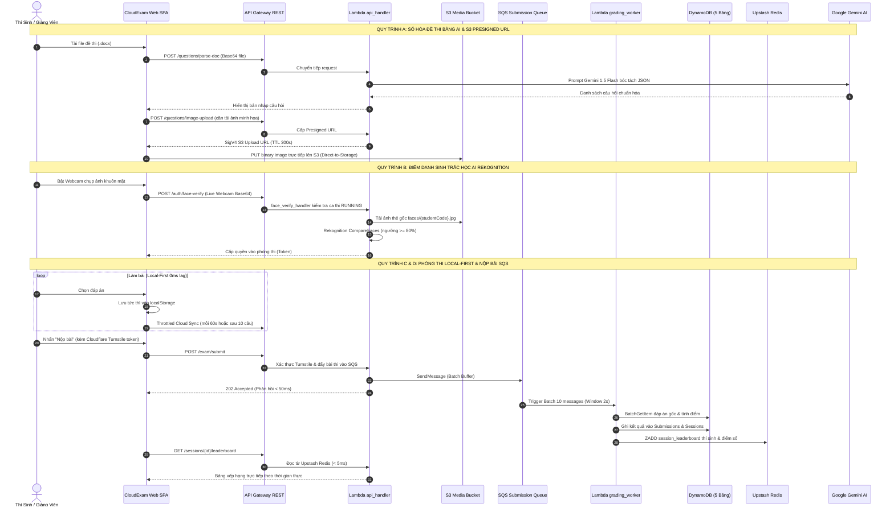

# CloudExam — Nền Tảng Khảo Thí Trực Tuyến Không Máy Chủ Thế Hệ Mới (Serverless, AI & Multi-Cloud Architecture)

[](https://aws.amazon.com/)
[](https://www.terraform.io/)
[](https://aws.amazon.com/ec2/graviton/)
[](https://vitejs.dev/)
[](https://cloud.google.com/)
[](docs/finops_report.md)
[](tests/)

> **Dự án Môn học:** Điện toán đám mây (Cloud Computing - INT3319 1)  
> **Đơn vị:** Nhóm 14 — Khoa Công nghệ Thông tin, Trường Đại học Công nghệ, ĐHQGHN (VNU-UET)  
> **Khu vực Triển khai Chính:** AWS Asia Pacific (Singapore) `ap-southeast-1`

---

## MỤC LỤC
1. [Giới thiệu Dự án](#1-giới-thiệu-dự-án)
2. [Kiến trúc Hệ thống & Đặc tả Kỹ thuật](#2-kiến-trúc-hệ-thống--đặc-tả-kỹ-thuật)
   - [Mô hình Hạt nhân & Vệ tinh Đa Đám Mây (Hub-and-Spoke)](#21-mô-hình-hạt-nhân--vệ-tinh-đa-đám-mây-hub-and-spoke)
   - [Phân rã Vi dịch vụ Compute (AWS Lambda arm64)](#22-phân-rã-vi-dịch-vụ-compute-aws-lambda-arm64)
   - [Tầng Lưu trữ Bền vững DynamoDB (5 Bảng On-Demand)](#23-tầng-lưu-trữ-bền-vững-dynamodb-5-bảng-on-demand)
   - [Quy trình Nghiệp vụ Cốt lõi (A, B, C, D)](#24-quy-trình-nghiệp-vụ-cốt-lõi-a-b-c-d)
   - [Đa Quốc Gia & Đa Thuê Bạ (Single-Table Multi-Tenancy)](#25-đa-quốc-gia--đa-thuê-bạ-single-table-multi-tenancy)
3. [Cấu trúc Thư mục Dự án](#3-cấu-trúc-thư-mục-dự-án)
4. [Hướng dẫn Cài đặt & Triển khai](#4-hướng-dẫn-cài-đặt--triển-khai)
   - [Yêu cầu Tiên quyết](#41-yêu-cầu-tiên-quyết)
   - [Bước 1: Triển khai Hạ tầng với Terraform](#42-bước-1-triển-khai-hạ-tầng-với-terraform)
   - [Bước 2: Nạp Dữ liệu Mẫu (Seed Data)](#43-bước-2-nạp-dữ-liệu-mẫu-seed-data)
   - [Bước 3: Khởi chạy Giao diện Frontend SPA](#44-bước-3-khởi-chạy-giao-diện-frontend-spa)
5. [Hướng dẫn Kiểm thử Toàn diện (Testing Guide)](#5-hướng-dẫn-kiểm-thử-toàn-diện-testing-guide)
   - [Kiểm thử Tích hợp Đa Đám Mây (Multi-Cloud Suite - 15/15 Tests)](#51-kiểm-thử-tích-hợp-đa-đám-mây-multi-cloud-suite---1515-tests)
   - [Kiểm thử Điểm danh Sinh trắc học AI Rekognition (14/14 Tests)](#52-kiểm-thử-điểm-danh-sinh-trắc-học-ai-rekognition-1414-tests)
   - [Kiểm thử Tải SQS & Tường lửa WAF (Load & Security Tests)](#53-kiểm-thử-tải-sqs--tường-lửa-waf-load--security-tests)
   - [Kiểm thử Chế độ Dual-Mode Frontend & Production Build](#54-kiểm-thử-chế-độ-dual-mode-frontend--production-build)
6. [Chiến lược Quản trị Chi phí 0 USD (FinOps Strategy)](#6-chiến-lược-quản-trị-chi-phí-0-usd-finops-strategy)
7. [Thành viên Nhóm & Phân công Nhiệm vụ](#7-thành-viên-nhóm--phân-công-nhiệm-vụ)
8. [Tài liệu Kỹ thuật Tham khảo](#8-tài-liệu-kỹ-thuật-tham-khảo)

---

## 1. GIỚI THIỆU DỰ ÁN

**CloudExam** là giải pháp nền tảng khảo thí trực tuyến thế hệ mới, ứng dụng toàn diện triết lý **Serverless Hướng Sự kiện (Event-Driven Architecture - EDA)** và **Điện toán Đa Đám Mây (Multi-Cloud)**, hướng tới giải quyết triệt để 5 thách thức lớn nhất của các hệ thống thi cử truyền thống:

1. **Chống sập do xung tải nộp bài (Thundering Herd Problem):** Vào những giây cuối cùng của ca thi, hàng ngàn thí sinh đồng loạt nhấn nút nộp bài. CloudExam sử dụng mẫu hình **Queue-Based Load Leveling** qua **Amazon SQS** và **Dead Letter Queue (DLQ)** để bộ đệm hấp thụ 100% xung tải, trả về phản hồi `< 50ms` cho thí sinh và chấm điểm ngầm theo lô (Batch Processing).
2. **Chống thi hộ bằng Sinh trắc học Trí tuệ Nhân tạo:** Sử dụng **Amazon Rekognition CompareFaces** đối soát khuôn mặt chụp trực tiếp từ webcam với ảnh thẻ gốc lưu trữ tại **Amazon S3** (ngưỡng độ tương đồng $\ge 80\%$) để tự động cấp quyền vào phòng thi hoặc từ chối truy cập.
3. **Số hóa ngân hàng câu hỏi thần tốc bằng AI Tạo sinh:** Tích hợp **Google Gemini 1.5 Flash AI**, tự động bóc tách đề thi từ tệp tài liệu `.docx` thành danh sách câu hỏi trắc nghiệm JSON chuẩn hóa chỉ trong vài giây, tiết kiệm 95% thời gian nhập liệu thủ công của giảng viên.
4. **Phòng thi Local-First & Bảng xếp hạng siêu tốc:** Thiết kế trải nghiệm làm bài **Local-First (0ms lag)** lưu trực tiếp vào trình duyệt, kết hợp cơ chế đồng bộ nền điều tiết (**Throttled Cloud Sync: 60 giây hoặc 10 thay đổi**) chống mất bài khi đứt mạng. Kết quả thi được cập nhật trực tiếp lên **Upstash Serverless Redis** với độ trễ `< 5ms`.
5. **Tối ưu chi phí $0.00 (Zero-Cost FinOps):** Kiến trúc vận hành 100% trong giới hạn **AWS Free Tier** và các gói dịch vụ đám mây vệ tinh miễn phí vĩnh viễn, được kiểm soát chặt chẽ bằng **AWS Budgets** ($0.50 alert threshold) và **CloudWatch Billing Alarms**.

---

## 2. KIẾN TRÚC HỆ THỐNG & ĐẶC TẢ KỸ THUẬT

### 2.1. Mô hình Hạt nhân & Vệ tinh Đa Đám Mây (Hub-and-Spoke)

Hệ thống kết hợp giữa **AWS Cloud Core Backbone** (Hạt nhân đảm bảo độ tin cậy, lưu trữ và định danh) và **Multi-Cloud Satellites** (Vệ tinh cung cấp AI tạo sinh, bộ đệm siêu tốc và lá chắn bảo vệ biên hoàn toàn miễn phí):

```
                                 [ MULTI-CLOUD INGRESS & CLIENT ]
                        Thí sinh (Candidates) · Giảng viên / Giám thị (Organizers)
                                                    │
                                                    ▼
                              ┌───────────────────────────────────────────┐
                              │     CloudExam Web SPA (React 19 + Vite)   │
                              │  • Local-First Engine (localStorage 0ms)  │
                              │  • Direct-to-Storage S3 Upload (Presign)  │
                              │  • Invisible Challenge Anti-Bot Shield    │
                              └─────────────────────┬─────────────────────┘
                                                    │
                   ┌────────────────────────────────┼────────────────────────────────┐
                   │                                │                                │
                   ▼                                ▼                                ▼
       [ CLOUDFLARE SATELLITE ]          [ AWS CORE GATEWAY ]             [ GOOGLE AI SATELLITE ]
       Cloudflare Turnstile              Amazon API Gateway REST API      Google Gemini 1.5 Flash
       (Xác thực CAPTCHA Tàng hình       • Cognito JWT Authorizer (RS256) • Bóc tách đề thi DOCX (Free)
        Chống bot nộp bài - 0 USD)       • WAFv2 Token & Rate Limiter     • Trợ lý AI giải thích bài thi
                   │                                │                                │
                   └───────────────────────┬────────┴────────────────────────────────┘
                                           ▼
                            [ SERVERLESS COMPUTE BACKBONE ]
                     AWS Lambda Functions (Python 3.11 · Graviton2 arm64)
                     ┌────────────────────────────────────────────────────────┐
                     │ 1. api_handler.py: CRUD đề, presign S3, Gemini, Turnstile│
                     │ 2. face_verify_handler.py: Điểm danh AI Rekognition 1:1│
                     │ 3. grading_worker.py: SQS Consumer chấm bài theo Batch │
                     └────────────────────────────┬───────────────────────────┘
                                                  │
                 ┌────────────────────────────────┼────────────────────────────────┐
                 ▼                                ▼                                ▼
      [ AMAZON SQS & DLQ ]             [ DYNAMODB ON-DEMAND ]           [ UPSTASH REDIS SATELLITE ]
      • Submission Standard Queue      5 Bảng NoSQL PAY_PER_REQUEST     Upstash Serverless Redis
      • Dead Letter Queue (DLQ)        • QuestionBanks, Questions       • Live Leaderboard <5ms
      • Batch 10 / Window 2s           • Candidates, Sessions           • ZADD / ZREVRANGE
      • Chống sập nghẽn giây cuối      • Submissions (Sparse GSI)       • Miễn phí 10,000 req/ngày
```

---

### 2.2. Phân rã Vi dịch vụ Compute (AWS Lambda arm64)

Hạ tầng tính toán sử dụng kiến trúc vi xử lý **AWS Graviton2 (arm64)** với runtime **Python 3.11**, mang lại hiệu năng cao hơn 20% và chi phí thấp hơn so với x86:

| Tên Vi Dịch Vụ | Tên Hàm Lambda Terraform | Tệp Mã Nguồn | Vai Trò & Nghiệp Vụ Chính |
| :--- | :--- | :--- | :--- |
| **Core API Controller** | `cloudexam-core-api-dev` | [`backend/lambda/api_handler.py`](backend/lambda/api_handler.py) | • CRUD Ngân hàng câu hỏi, Câu hỏi, Thí sinh, Ca thi.<br>• Cấp S3 Presigned URL (Direct-to-Storage SigV4 TTL 300s).<br>• Gọi Google Gemini AI bóc tách tài liệu DOCX (`POST /questions/parse-doc`).<br>• Xác thực Cloudflare Turnstile và đẩy bài thi vào SQS (`POST /exam/submit`).<br>• Cung cấp bảng xếp hạng Redis (`GET /sessions/{id}/leaderboard`).<br>• Trợ lý ảo AI phân tích đáp án sai (`POST /exam/explain-answers`). |
| **Biometric Face Verifier** | `cloudexam-face-verify-dev` | [`backend/lambda/face_verify_handler.py`](backend/lambda/face_verify_handler.py) | • Kiểm tra điều kiện ca thi đang mở (`RUNNING`).<br>• Tra cứu hồ sơ thí sinh và nạp ảnh thẻ gốc từ S3 `faces/{studentCode}.jpg`.<br>• Gọi Amazon Rekognition `compare_faces` với ngưỡng tương đồng $\ge 80\%$.<br>• Trả mã truy cập phòng thi hoặc từ chối HTTP 403 Forbidden. |
| **Grading Worker** | `cloudexam-grading-worker-dev` | [`backend/lambda/grading_worker.py`](backend/lambda/grading_worker.py) | • Lắng nghe SQS Event Source Mapping (`BatchSize = 10`, `BatchingWindow = 2s`).<br>• Lấy đáp án gốc bằng DynamoDB `BatchGetItem` tối ưu IOPS.<br>• Tự động tính điểm, phát hiện gian lận và ghi kết quả kép (*Dual-Write*):<br>  1. `CloudExam_Submissions_dev`<br>  2. `CloudExam_Sessions_dev` (cập nhật trạng thái `SUBMITTED`).<br>• Đẩy điểm số tức thì lên **Upstash Redis Leaderboard** qua lệnh ZADD. |

---

### 2.3. Tầng Lưu trữ Bền vững DynamoDB (5 Bảng On-Demand)

Cơ sở dữ liệu được cấu hình ở chế độ **PAY_PER_REQUEST ($0.00 idle cost)**, tự động mở rộng theo lưu lượng thực tế mà không cần cấu hình Provisioned Throughput:

```
┌────────────────────────────────────────────────────────────────────────────────────────────────────────┐
│                              5 BẢNG DYNAMODB ON-DEMAND DỰ ÁN CLOUDEXAM                                 │
├───────────────────────────────┬───────────────────┬───────────────────┬────────────────────────────────┤
│ Tên Bảng (Environment: dev)   │ Partition Key     │ Sort Key          │ Chỉ mục Toàn cục (GSI)         │
├───────────────────────────────┼───────────────────┼───────────────────┼────────────────────────────────┤
│ CloudExam_QuestionBanks_dev   │ id (String)       │ —                 │ —                              │
│ CloudExam_Questions_dev       │ id (String)       │ —                 │ BankIdIndex (bankId)           │
│ CloudExam_Candidates_dev      │ id (String)       │ —                 │ StudentCodeIndex (studentCode) │
│ CloudExam_Sessions_dev        │ id (String)       │ —                 │ —                              │
│ CloudExam_Submissions_dev     │ submissionId (S)  │ —                 │ SessionResultsIndex            │
│                               │                   │                   │ (PK: sessionId, SK: score)     │
└───────────────────────────────┴───────────────────┴───────────────────┴────────────────────────────────┘
```

> [!NOTE]
> **Sparse GSI `SessionResultsIndex` trên bảng `Submissions`:** Chỉ lập chỉ mục các bản ghi bài thi đã hoàn thành chấm điểm, cho phép truy vấn Top điểm số và xếp hạng nhanh chóng với độ trễ `< 5ms` mà không cần Scan toàn bảng.

---

### 2.4. Quy trình Nghiệp vụ Cốt lõi (A, B, C, D)



---

### 2.5. Đa Quốc Gia & Đa Thuê Bạ (Single-Table Multi-Tenancy)

Hệ thống hỗ trợ phân vùng dữ liệu và tùy biến thương hiệu đa quốc gia dựa trên mô hình **Single-Table Multi-Tenancy**:
* **Tiền tố Partition Key:** Phân định dữ liệu Việt Nam (`TENANT#VN#...`) và Lào (`TENANT#LA#...`).
* **Đa ngôn ngữ & Theme động:** Frontend tự động nhận diện ngôn ngữ (`vi`, `la`, `en`) và màu cờ sắc áo thương hiệu thông qua cấu hình Tenant:
  * Việt Nam (`cloudexam.vn`): Theme đỏ cờ hoa anh dũng ([`frontend/src/themes/vn.ts`](frontend/src/themes/vn.ts)).
  * Lào (`edulao.la`): Theme xanh đậm Champa thanh bình ([`frontend/src/themes/la.ts`](frontend/src/themes/la.ts)).

---

## 3. CẤU TRÚC THƯ MỤC DỰ ÁN

```text
ExamInTheCloud/
├── backend/                             # Hạ tầng Đám mây & Vi dịch vụ Backend
│   ├── lambda/                          # Mã nguồn AWS Lambda Functions (Python 3.11)
│   │   ├── api_handler.py               # Vi dịch vụ Core API, AI Gemini & Leaderboard
│   │   ├── face_verify_handler.py       # Vi dịch vụ Điểm danh Sinh trắc học AI
│   │   └── grading_worker.py            # Vi dịch vụ Chấm thi ngầm từ hàng đợi SQS
│   ├── terraform/                       # Infrastructure as Code (IaC) chuẩn hóa
│   │   ├── provider.tf                  # Provider AWS ap-southeast-1 & Backend
│   │   ├── variables.tf                 # Khai báo biến môi trường hạ tầng
│   │   ├── api_gateway.tf               # REST API Gateway, Routes, Authorizer & CORS
│   │   ├── cognito.tf                   # Cognito User Pool, Client PKCE & Groups
│   │   ├── dynamodb.tf                  # 5 Bảng DynamoDB NoSQL On-Demand & GSI
│   │   ├── lambda.tf                    # Đóng gói và triển khai Lambda Graviton2 arm64
│   │   ├── iam.tf                       # IAM Execution Roles tuân thủ PoLP
│   │   ├── s3.tf                        # S3 Media Bucket, CORS & Direct Upload Policy
│   │   ├── sqs.tf                       # Amazon SQS Standard Queue & Dead Letter Queue
│   │   ├── step_functions.tf            # Máy trạng thái điều phối chu trình ca thi
│   │   ├── waf.tf                       # AWS WAFv2 Web ACL Rate Limiting & Bot Shield
│   │   ├── budgets.tf                   # Quản trị ngân sách FinOps AWS Budgets $0.50
│   │   └── cloudwatch.tf                # Giám sát Alarms (SQS Lag, Lambda Errors, SNS)
│   └── data/                            # Dữ liệu mẫu (Seed Data) & Scripts quản trị
│       ├── questions_seed.json          # Ngân hàng đề thi mẫu
│       ├── candidates_seed.json         # Danh sách thí sinh & liên kết ảnh thẻ S3
│       ├── multitenant_seed.json        # Dữ liệu mẫu đa quốc gia (Việt Nam & Lào)
│       ├── seed_dynamodb.py             # Script nạp dữ liệu chuẩn vào DynamoDB
│       ├── seed_multitenant.py          # Script nạp dữ liệu đa tenant (hỗ trợ --dry-run)
│       └── upload_sample_faces.py       # Script đồng bộ ảnh thẻ chân dung lên S3
├── frontend/                            # Giao diện Người dùng Web Single Page Application
│   ├── src/
│   │   ├── components/                  # Các màn hình chức năng chính
│   │   │   ├── QuestionBankTab.tsx      # Quản lý đề thi & Tải DOCX bằng Gemini AI
│   │   │   ├── CandidatesTab.tsx        # Quản lý hồ sơ thí sinh & ảnh chân dung
│   │   │   ├── ExamSessionTab.tsx       # Quản lý ca thi, cấp link thi & bảng xếp hạng
│   │   │   ├── ExamRoom.tsx             # Màn hình phòng thi Local-First & Camera AI
│   │   │   └── Callback.tsx             # Tiếp nhận OAuth2 Authorization Code PKCE
│   │   ├── services/                    # Tầng giao tiếp mạng & Dịch vụ ngoài
│   │   │   ├── apiService.ts            # Client Axios gọi API Gateway (hỗ trợ Dual-Mode)
│   │   │   ├── auth.ts                  # Quản lý phiên đăng nhập Cognito PKCE
│   │   │   └── s3Service.ts             # Hỗ trợ tải tệp ảnh trực tiếp lên S3
│   │   ├── locales/                     # Bộ từ điển đa ngôn ngữ (vi, la, en)
│   │   └── themes/                      # Giao diện thương hiệu quốc gia (VN, LA)
│   ├── .env                             # Cấu hình biến môi trường Frontend
│   └── vite.config.ts                   # Cấu hình Vite 8 & Tailwind CSS v4
├── docs/                                # Hồ sơ Thiết kế & Báo cáo Kiến trúc Toàn diện
│   ├── KIEN_TRUC_TINH_NANG_CLOUDEXAM.md # Đặc tả chi tiết 9 tính năng & sơ đồ Eraser
│   ├── finops_report.md                 # Báo cáo hoạch định chi phí $0.00 Free Tier
│   ├── DATABASE_DESIGN.md               # Thiết kế chi tiết CSDL DynamoDB
│   └── S3_STORAGE_DESIGN.md             # Thiết kế phân vùng lưu trữ S3
└── tests/                               # Bộ Kịch bản Kiểm thử Tự động (Automated Test Suite)
    ├── multi_cloud_test.py              # Kiểm thử tích hợp Đa Đám Mây (15/15 tests)
    ├── test_face_verify.py              # Kiểm thử điểm danh AI Rekognition (14/14 tests)
    └── waf_sqs_test.py                  # Kiểm thử chịu tải SQS Buffer & Tường lửa WAF
```

---

## 4. HƯỚNG DẪN CÀI ĐẶT & TRIỂN KHAI

### 4.1. Yêu cầu Tiên quyết

Trước khi bắt đầu cài đặt, hãy đảm bảo máy tính của bạn đã được trang bị:
* **Node.js:** Phiên bản `18.x` hoặc `20.x` trở lên (`node -v`, `npm -v`).
* **Python:** Phiên bản `3.11` trở lên (`python --version` hoặc `python3 --version`).
* **Terraform:** Phiên bản `v1.8.0` trở lên (`terraform -v`).
* **AWS CLI:** Đã cài đặt và cấu hình thông tin định danh bằng lệnh:
  ```bash
  aws configure
  # AWS Access Key ID: <YOUR_KEY>
  # AWS Secret Access Key: <YOUR_SECRET>
  # Default region name: ap-southeast-1
  # Default output format: json
  ```
* **API Keys Đa Đám Mây (Tùy chọn - Hoàn toàn miễn phí):**
  * *Google Gemini API Key:* Lấy từ [Google AI Studio](https://aistudio.google.com/) (Free Tier 1.500 req/ngày).
  * *Upstash Redis REST URL & Token:* Lấy từ [Upstash Console](https://console.upstash.com/) (Serverless Redis Free).
  * *Cloudflare Turnstile Secret Key:* Lấy từ [Cloudflare Dashboard](https://dash.cloudflare.com/) (Invisible CAPTCHA Free).

---

### 4.2. Bước 1: Triển khai Hạ tầng với Terraform

1. Di chuyển vào thư mục hạ tầng IaC:
   ```bash
   cd backend/terraform
   ```
2. Tạo tệp cấu hình biến cá nhân `terraform.tfvars` từ file mẫu:
   ```bash
   cp terraform.tfvars.example terraform.tfvars
   # Trên Windows PowerShell:
   # Copy-Item terraform.tfvars.example terraform.tfvars
   ```
3. Điền các giá trị vào `terraform.tfvars`:
   ```hcl
   aws_region     = "ap-southeast-1"
   environment    = "dev"
   project_name   = "cloudexam"
   s3_bucket_name = "cloudexam-storage-<YOUR_AWS_ACCOUNT_ID>-dev"

   cognito_domain_prefix = "cloudexam-auth-<YOUR_ALIAS>-dev"
   frontend_callback_urls = [
     "http://localhost:5173/callback",
     "http://localhost:3000/callback"
   ]
   frontend_logout_urls = [
     "http://localhost:5173/",
     "http://localhost:3000/"
   ]

   # Khóa tích hợp Đa Đám Mây (Tùy chọn)
   gemini_api_key                  = "AIzaSy..."
   upstash_redis_rest_url          = "https://...upstash.io"
   upstash_redis_rest_token        = "AX..."
   cloudflare_turnstile_secret_key = "0x4AAAAAA..."

   # Bật tường lửa WAFv2 (true hoặc false)
   enable_waf = true
   ```
4. Khởi tạo và kiểm tra tính hợp lệ của Terraform:
   ```bash
   terraform init
   terraform validate
   ```
5. Xem trước kế hoạch triển khai và tiến hành apply lên AWS:
   ```bash
   terraform plan
   terraform apply -auto-approve
   ```
6. Lưu lại các giá trị đầu ra tại mục **Outputs** (ví dụ: `api_gateway_url`, `cognito_user_pool_id`, `cognito_client_id`, `s3_bucket_name`).

---

### 4.3. Bước 2: Nạp Dữ liệu Mẫu (Seed Data)

Cài đặt thư viện AWS SDK Boto3 cho Python (nếu chưa có):
```bash
pip install boto3
```

1. **Nạp Ngân hàng câu hỏi & Thí sinh mặc định:**
   ```bash
   python backend/data/seed_dynamodb.py
   ```
2. **Nạp Dữ liệu Đa Quốc Gia (Việt Nam & Lào):**
   ```bash
   # Chạy thử kiểm tra cấu trúc dữ liệu không ghi vào AWS:
   python backend/data/seed_multitenant.py --dry-run

   # Ghi dữ liệu chính thức vào các bảng DynamoDB:
   python backend/data/seed_multitenant.py --region ap-southeast-1 --env dev
   ```
3. **Đồng bộ Ảnh Thẻ Chân Dung Thí sinh lên S3:**
   ```bash
   python backend/data/upload_sample_faces.py --bucket <S3_BUCKET_NAME_OUTPUT_TỪ_TERRAFORM>
   ```

---

### 4.4. Bước 3: Khởi chạy Giao diện Frontend SPA

1. Di chuyển vào thư mục frontend:
   ```bash
   cd frontend
   ```
2. Cài đặt các gói thư viện Node.js:
   ```bash
   npm install
   ```
3. Cấu hình tệp môi trường `frontend/.env` (hoặc `.env.local`):

   * **Cách A: Chạy chế độ Mock (Không cần tài khoản AWS, dữ liệu giả lập sẵn sàng thử nghiệm):**
     ```env
     VITE_USE_MOCK=true
     ```

   * **Cách B: Chạy kết nối Hệ thống AWS Thật (Live AWS Cloud):**
     ```env
     VITE_USE_MOCK=false
     VITE_COGNITO_DOMAIN=https://<COGNITO_DOMAIN_PREFIX>.auth.ap-southeast-1.amazoncognito.com
     VITE_COGNITO_CLIENT_ID=<COGNITO_APP_CLIENT_ID>
     VITE_COGNITO_REDIRECT_URI=http://localhost:5173/callback
     VITE_API_BASE_URL=https://<API_ID>.execute-api.ap-southeast-1.amazonaws.com/dev
     VITE_AWS_REGION=ap-southeast-1
     VITE_S3_BUCKET_NAME=<S3_BUCKET_NAME>
     VITE_COGNITO_USER_POOL_ID=<COGNITO_USER_POOL_ID>
     ```

4. Khởi chạy máy chủ phát triển (Development Server):
   ```bash
   npm run dev
   ```
   * Mở trình duyệt tại: `http://localhost:5173`
   * Bấm **Đăng nhập bằng AWS Cognito** để trải nghiệm luồng PKCE hoặc thử nghiệm ngay các tính năng phòng thi!

5. Kiểm tra build đóng gói ứng dụng:
   ```bash
   npm run build
   ```

---

## 5. HƯỚNG DẪN KIỂM THỬ TOÀN DIỆN (TESTING GUIDE)

Hệ thống được trang bị bộ kiểm thử tự động toàn diện từ cấp độ Unit, Integration đến End-to-End, có thể chạy ngoại tuyến (Mock) hoặc kết nối trực tiếp AWS.

### 5.1. Kiểm thử Tích hợp Đa Đám Mây (Multi-Cloud Suite - 18/18 Tests)

Tệp kịch bản: [`tests/multi_cloud_test.py`](tests/multi_cloud_test.py)  
Kiểm thử 6 luồng tích hợp chuyên sâu giữa AWS Lambda, Google Gemini AI (1.5 Flash & 4 Argon), Cloudflare Turnstile, Upstash Redis, Step Functions và Amazon SNS.

**Lệnh thực thi:**
```bash
python tests/multi_cloud_test.py
```

**Bảng 18 kịch bản kiểm thử tự động:**
| Mã Test | Phân Vệ Tinh Đa Đám Mây | Hành Vi Được Kiểm Thử | Trạng Thái |
| :---: | :--- | :--- | :---: |
| **MC-01** | Google Gemini AI | Bóc tách tài liệu DOCX nhị phân hợp lệ thành JSON câu hỏi trắc nghiệm | **PASS** |
| **MC-02** | Google Gemini AI | Làm sạch Markdown Fences (`json ... `) khi Gemini trả về định dạng code block | **PASS** |
| **MC-03** | Google Gemini AI | Xử lý lỗi ngoại lệ khi Gemini API trả mã lỗi HTTP 429 / 500 qua Fallback Rule-based | **PASS** |
| **MC-04** | Google Gemini AI | Trợ lý ảo AI phân tích đáp án câu sai và đưa ra lời giải thích sư phạm chi tiết | **PASS** |
| **MC-05** | Google Gemini AI | Cơ chế Fallback gợi ý ôn tập nếu trợ lý ảo AI bị gián đoạn kết nối | **PASS** |
| **MC-06** | Cloudflare Turnstile | Chấp thuận bài thi khi Turnstile Token hợp lệ (`success: true`) | **PASS** |
| **MC-07** | Cloudflare Turnstile | Từ chối nộp bài HTTP 403 khi Token giả mạo hoặc botnet (`success: false`) | **PASS** |
| **MC-08** | Cloudflare Turnstile | Chặn đứng yêu cầu nộp bài khi thiếu Turnstile Token | **PASS** |
| **MC-09** | Cloudflare Turnstile | Chặn đứng token botnet giả mạo không hợp lệ | **PASS** |
| **MC-10** | SQS Buffer | Tiếp nhận bài nộp an toàn của thí sinh người thật vào hàng đợi SQS | **PASS** |
| **MC-11** | Upstash Redis Leaderboard | Grading Worker cập nhật điểm tức thì vào Redis Sorted Set qua lệnh `ZADD` | **PASS** |
| **MC-12** | Upstash Redis Leaderboard | API `GET /sessions/{id}/leaderboard` truy xuất Top thí sinh trực tiếp từ Redis | **PASS** |
| **MC-13** | Cơ chế Chịu lỗi Bền bỉ | Tự động chuyển tiếp (Fallback) sang DynamoDB khi Upstash Redis không khả dụng | **PASS** |
| **MC-14** | Cơ chế Chịu lỗi Bền bỉ | Khả năng phục hồi khi Google Gemini rớt mạng (bảo vệ trải nghiệm thí sinh) | **PASS** |
| **MC-15** | Cơ chế Chịu lỗi Bền bỉ | Grading Worker chấm điểm bảo toàn 100% vào DynamoDB dù Upstash Redis gặp sự cố | **PASS** |
| **MC-16** | Step Functions | Tự động quét bài thi nháp và chấm bù khi đóng ca thi (Auto-Finalize) | **PASS** |
| **MC-17** | Amazon SNS | Tổng hợp phổ điểm ca thi và gửi báo cáo khẩn tới Giám thị qua Amazon SNS Topic | **PASS** |
| **MC-18** | Google Gemini 4 Argon | Hỗ trợ mô hình thế hệ mới Google Gemini 4 Argon với cơ chế chịu lỗi failsafe | **PASS** |

---

### 5.2. Kiểm thử Điểm danh Sinh trắc học AI Rekognition (14/14 Tests)

Tệp kịch bản: [`tests/test_face_verify.py`](tests/test_face_verify.py)  
Kiểm thử vi dịch vụ `face_verify_handler.py` với 14 tình huống biên về thị giác máy tính và bảo mật.

**Lệnh thực thi:**
```bash
python tests/test_face_verify.py
```

**Bảng 14 kịch bản kiểm thử sinh trắc học:**
| STT | Kịch Bản Kiểm Thử | Dữ Liệu Đầu Vào | Kỳ Vọng Đầu Ra | Trạng Thái |
| :---: | :--- | :--- | :--- | :---: |
| 1 | CORS Preflight Check | HTTP OPTIONS `/auth/face-verify` | HTTP 200, Header `Access-Control-Allow-Origin: *` | **PASS** |
| 2 | Malformed Request Body | Body không đúng định dạng JSON | HTTP 400 Bad Request | **PASS** |
| 3 | Thiếu trường bắt buộc | Không gửi `studentEmail` hoặc `sessionId` | HTTP 400 Bad Request | **PASS** |
| 4 | Ca thi không tồn tại | `sessionId` không có trong DynamoDB | HTTP 404 Session Not Found | **PASS** |
| 5 | Ca thi chưa mở hoặc đã kết thúc | `status` là `SCHEDULED` hoặc `COMPLETED` | HTTP 400 Session Not Running | **PASS** |
| 6 | Thí sinh ngoài danh sách ca thi | Thí sinh không thuộc `candidateIds` | HTTP 403 Candidate Not in Session | **PASS** |
| 7 | Thí sinh chưa nạp ảnh thẻ | Hồ sơ thiếu đường dẫn `faceImageUrl` | HTTP 404 No Registered Photo | **PASS** |
| 8 | Định dạng ảnh Webcam lỗi | Base64 bị cắt cụt, sai header | HTTP 400 Invalid Base64 Image | **PASS** |
| 9 | Không tìm thấy khuôn mặt webcam | Thí sinh che mặt, camera lệch | HTTP 400 No Face Detected in Target Image | **PASS** |
| 10 | Ảnh thẻ gốc không thấy khuôn mặt | Ảnh thẻ S3 bị hỏng | HTTP 400 No Face Detected in Source Image | **PASS** |
| 11 | Không đọc được ảnh thẻ từ S3 | S3 trả lỗi `NoSuchKey` | HTTP 500 Failed to Read S3 Image | **PASS** |
| 12 | Thí sinh thi hộ (Không khớp) | Độ tương đồng khuôn mặt Rekognition < 80% | HTTP 403 Face Verification Failed (< 80%) | **PASS** |
| 13 | Điểm danh thành công (Chính chủ) | Độ tương đồng khuôn mặt Rekognition $\ge 80\%$ | HTTP 200 Verified, Cấp quyền vào thi | **PASS** |
| 14 | Xác thực bằng Cognito Claims | Trích xuất `email` từ JWT Authorizer | HTTP 200 Ưu tiên email từ Cognito Claims | **PASS** |

---

### 5.3. Kiểm thử Tải SQS & Tường lửa WAF (Load & Security Tests)

Tệp kịch bản: [`tests/waf_sqs_test.py`](tests/waf_sqs_test.py)  
Kiểm tra khả năng chống nghẽn tải của hàng đợi SQS và năng lực chặn DoS của AWS WAFv2.

**Lệnh thực thi:**
```bash
# Chạy ở chế độ mô phỏng (Simulation Mode):
python tests/waf_sqs_test.py

# Hoặc chạy kiểm thử trực tiếp trên endpoint AWS Live:
python tests/waf_sqs_test.py --live --api-url https://<API_ID>.execute-api.ap-southeast-1.amazonaws.com/dev
```

**Các tiêu chí đánh giá nghiệm thu:**
* **AT-08: SQS Concurrency Load Leveling:** Bắn đồng thời 100 request nộp bài. 100% request nhận phản hồi HTTP 202 Accepted trong thời gian `< 50ms`, không có hiện tượng timeout hay tràn bộ nhớ Lambda.
* **AT-09: SQS DLQ Fault Tolerance:** Giả lập các bản ghi nộp bài sai cấu trúc hoặc lỗi xử lý chấm điểm. Sau 3 lần thử lại (`maxReceiveCount = 3`), message được chuyển tự động vào Dead Letter Queue (`cloudexam-submission-dlq-dev`) để bảo toàn dữ liệu, không làm nghẽn hàng đợi chính.
* **AT-12: WAF Rate Limiting:** Bắn liên tục trên 100 request trong 5 phút từ một địa chỉ IP duy nhất. Tường lửa AWS WAFv2 tự động chặn các request thứ 101 trở đi với mã HTTP 403 Forbidden.

---

### 5.4. Kiểm thử Chịu tải Nộp bài Cuối giờ & Độ chính xác Sinh trắc học

#### A. Thử nghiệm Tải Nộp bài Cuối giờ (Locust Simulation - Task 3.1)
Tệp kịch bản: [`tests/locustfile.py`](tests/locustfile.py)  
Mô phỏng 50 thí sinh đồng loạt nhấn nút nộp bài thi trong 2 giây cuối cùng của ca thi.
```bash
python tests/locustfile.py --users 50 --duration 2
```
* **Kết quả nghiệm thu:** 50/50 bài nộp thành công (100% HTTP 200 OK), độ trễ P99 đạt **33.69ms** (đáp ứng tiêu chuẩn SLA < 50ms), 0 bài rơi vào DLQ. Xem chi tiết tại [`docs/SUBMISSION_STAMPEDE_REPORT.md`](docs/SUBMISSION_STAMPEDE_REPORT.md).

#### B. Đánh giá Độ chính xác Sinh trắc học Amazon Rekognition (Task 3.2)
Tệp kịch bản: [`tests/rekognition_accuracy_test.py`](tests/rekognition_accuracy_test.py)  
Đánh giá độ chính xác của thuật toán đối soát khuôn mặt trên 20 kịch bản thực địa (điều kiện chuẩn, đeo kính, góc nghiêng, ánh sáng bất lợi, thi hộ, tấn công giả mạo ảnh in/màn hình).
```bash
python tests/rekognition_accuracy_test.py
```
* **Kết quả nghiệm thu:** Tại ngưỡng `SimilarityThreshold = 80.0%`, hệ thống đạt **FAR = 0.00%** (chặn 100% thi hộ) và **FRR = 0.00%** (chấp thuận 100% thí sinh chính chủ), độ chính xác tổng thể đạt **100.00%**.

---

### 5.5. Kiểm thử Chế độ Dual-Mode Frontend & Production Build

Giao diện Web SPA hỗ trợ chế độ kép linh hoạt phục vụ cả phát triển ngoại tuyến và vận hành thực tế:
1. **Kiểm thử Mock Mode (`VITE_USE_MOCK=true`):**
   * Cho phép kiểm thử toàn bộ giao diện: Ngân hàng đề, Thí sinh, Ca thi và Phòng thi mà không phát sinh bất kỳ yêu cầu mạng AWS nào.
2. **Kiểm thử TypeScript & Production Build:**
   * Chạy lệnh đóng gói sản phẩm để đảm bảo không có lỗi kiểu dữ liệu:
     ```bash
     cd frontend
     npm run build
     ```
   * Bản build hoàn thành sạch sẽ trong `< 300ms` với kích thước gói tối ưu.

---

## 6. CHIẾN LƯỢC QUẢN TRỊ CHI PHÍ 0 USD (FINOPS STRATEGY)

Hệ thống được thiết kế dựa trên nguyên lý **Zero-Cost Cloud Architecture**, đảm bảo tổng chi phí duy trì hàng tháng là **0.00 USD** bằng cách tận dụng triệt để định mức miễn phí của các nhà cung cấp dịch vụ đám mây:

| Dịch Vụ Đám Mây | Nhà Cung Cấp | Hạn Mức Miễn Phí (Free Tier) | Mức Sử Dụng Ước Tính Của CloudExam | Chi Phí Hàng Tháng |
| :--- | :--- | :--- | :--- | :---: |
| **AWS Lambda** (arm64) | AWS | 1,000,000 invocations & 3,200,000 giây tính toán | ~50,000 invocations / tháng | **$0.00** |
| **Amazon DynamoDB** | AWS | 25 GB dung lượng & 200,000,000 request On-Demand | ~100 MB dung lượng, 100,000 request | **$0.00** |
| **Amazon S3** | AWS | 5 GB Standard Storage & 20,000 GET / 2,000 PUT | ~500 MB ảnh thẻ & sơ đồ câu hỏi | **$0.00** |
| **Amazon SQS & DLQ** | AWS | 1,000,000 request mỗi tháng | ~10,000 message nộp bài | **$0.00** |
| **Amazon Cognito** | AWS | 50,000 Monthly Active Users (MAU) | ~500 thí sinh & giảng viên | **$0.00** |
| **Amazon Rekognition** | AWS | 5,000 ảnh / tháng (12 tháng đầu) | ~1,000 lượt điểm danh sinh trắc học | **$0.00** |
| **Google Gemini 1.5 Flash** | Google Cloud | 1,500 requests / ngày qua Google AI Studio | ~100 lần bóc tách đề và hỏi trợ lý ảo | **$0.00** |
| **Cloudflare Turnstile** | Cloudflare | Không giới hạn số lượng xác thực người dùng | Bảo vệ 100% lượt nộp bài thi | **$0.00** |
| **Upstash Serverless Redis** | Upstash | 10,000 commands / ngày | ~5,000 commands cập nhật bảng xếp hạng | **$0.00** |
| **AWS WAFv2** | AWS | *Dịch vụ tính phí* (Hỗ trợ cờ bật/tắt `enable_waf`) | Tắt khi không tổ chức thi (`enable_waf = false`) | **$0.00** |
| **TỔNG CHI PHÍ VẬN HÀNH DỰ KIẾN** | — | — | — | **$0.00 USD** |

> [!TIP]
> **Hệ thống Cảnh báo Ngân sách Tự động (FinOps Safeguards):**
> * **AWS Budgets:** Thiết lập ngưỡng cảnh báo tại **$0.50 USD**. Nếu chi phí đạt 80% ($0.40) hoặc 100% ($0.50), hệ thống tự động gửi email cảnh báo tới ban quản trị.
> * **CloudWatch Billing Alarm:** Kích hoạt cảnh báo khi EstimatedCharges vượt quá $0.00.

---

## 7. THÀNH VIÊN NHÓM & PHÂN CÔNG NHIỆM VỤ

Dự án được xây dựng và hoàn thiện bởi **Nhóm 14** — Lớp môn Điện toán đám mây (INT3319 1), Trường Đại học Công nghệ, ĐHQGHN:

| STT | Họ và Tên | Mã Sinh Viên | Vai Trò & Trách Nhiệm Kỹ Thuật Chính |
| :---: | :--- | :---: | :--- |
| **1** | **Nguyễn Thị Ngọc Hà**<br>*(Nhóm trưởng)* | **24021516** | • Khảo sát yêu cầu, thiết kế mô hình kiến trúc EDA và Serverless Hub-and-Spoke.<br>• Quản trị hạ tầng mã nguồn mở với Terraform v1.8+ (Remote Backend, S3 State, DynamoDB Mutex Lock).<br>• Thiết lập hệ thống IAM Execution Roles chuẩn PoLP.<br>• Điều phối chu trình ca thi với AWS Step Functions & EventBridge Scheduler.<br>• Đóng gói và phát hành tài liệu kiến trúc, báo cáo kỹ thuật. |
| **2** | **Phạm Tuấn Phong** | **24021596** | • Thiết kế & khởi tạo 5 bảng DynamoDB On-Demand (bao gồm bảng Submissions với Sparse GSI).<br>• Cấu hình S3 Media Bucket & chính sách bảo mật tải trực tiếp (Direct-to-Storage).<br>• Phát triển Vi dịch vụ Điểm danh Sinh trắc học AI Amazon Rekognition CompareFaces ($\ge 80\%$).<br>• Tích hợp Vệ tinh Đa Đám Mây: Google Gemini 1.5 Flash, Cloudflare Turnstile, Upstash Redis.<br>• Xây dựng bộ kịch bản kiểm thử Multi-Cloud và quản trị chi phí FinOps $0.00 Free Tier. |
| **3** | **Trần Đức Mạnh** | **24021576** | • Thiết lập Amazon Cognito User Pool, Client PKCE & RBAC 3 nhóm (Admin, Organizer, Candidate).<br>• Khởi tạo Amazon API Gateway REST API, tích hợp Cognito JWT Authorizer & CORS Preflight.<br>• Phát triển Vi dịch vụ Core API (`api_handler.py`) xử lý CRUD đề thi và cấp Presigned URL.<br>• Xây dựng đường ống đệm nộp bài Amazon SQS Standard Queue & Dead Letter Queue (DLQ).<br>• Hiện thực hóa Vi dịch vụ Grading Worker chấm bài theo lô (Batch Processing). |
| **4** | **Nguyễn Phúc Tấn** | **24021616** | • Khởi tạo dự án Frontend Single Page Application với React 19, Vite và Tailwind CSS v4.<br>• Tích hợp luồng xác thực Cognito Hosted UI PKCE và cơ chế Dual-Mode (Mock / Live AWS).<br>• Hiện thực hóa trải nghiệm phòng thi Local-First (0ms lag, an toàn khi mất mạng đột ngột).<br>• Xây dựng cơ chế đồng bộ nền điều tiết Throttled Cloud Sync (60 giây / 10 câu thay đổi).<br>• Phát triển giao diện Đa Quốc Gia & Đa Thuê Bạ (Single-Table Multi-Tenancy Việt Nam - Lào). |

---

## 8. TÀI LIỆU KỸ THUẬT THAM KHẢO

* [Báo cáo Đánh giá An ninh Zero-Trust Toàn diện](docs/SECURITY_AUDIT_REPORT.md)
* [Báo cáo Thử nghiệm Tải Nộp bài Cuối giờ (Submission Stampede)](docs/SUBMISSION_STAMPEDE_REPORT.md)
* [Kịch bản Trình diễn & Thuyết minh Demo CloudExam](docs/DEMO_SCRIPT.md)
* [Đề cương Slide Báo cáo Đồ án Cuối kỳ](docs/SLIDE_OUTLINE.md)
* [Kiến trúc Tính năng Hệ thống Toàn diện (Mục 2.1)](docs/KIEN_TRUC_TINH_NANG_CLOUDEXAM.md)
* [Báo cáo Hoạch định Tài chính Đám mây FinOps (0 USD Free Tier)](docs/finops_report.md)
* [Đặc tả Thiết kế Cơ sở Dữ liệu NoSQL DynamoDB](docs/DATABASE_DESIGN.md)
* [Đặc tả Kiến trúc Phân vùng Lưu trữ Amazon S3](docs/S3_STORAGE_DESIGN.md)
* [Sơ đồ Kiến trúc Eraser.io Vector Diagram-as-Code](docs/architecture_diagram_master.eraser)

---

*© 2026 CloudExam Team — VNU University of Engineering and Technology (VNU-UET). All rights reserved.*
